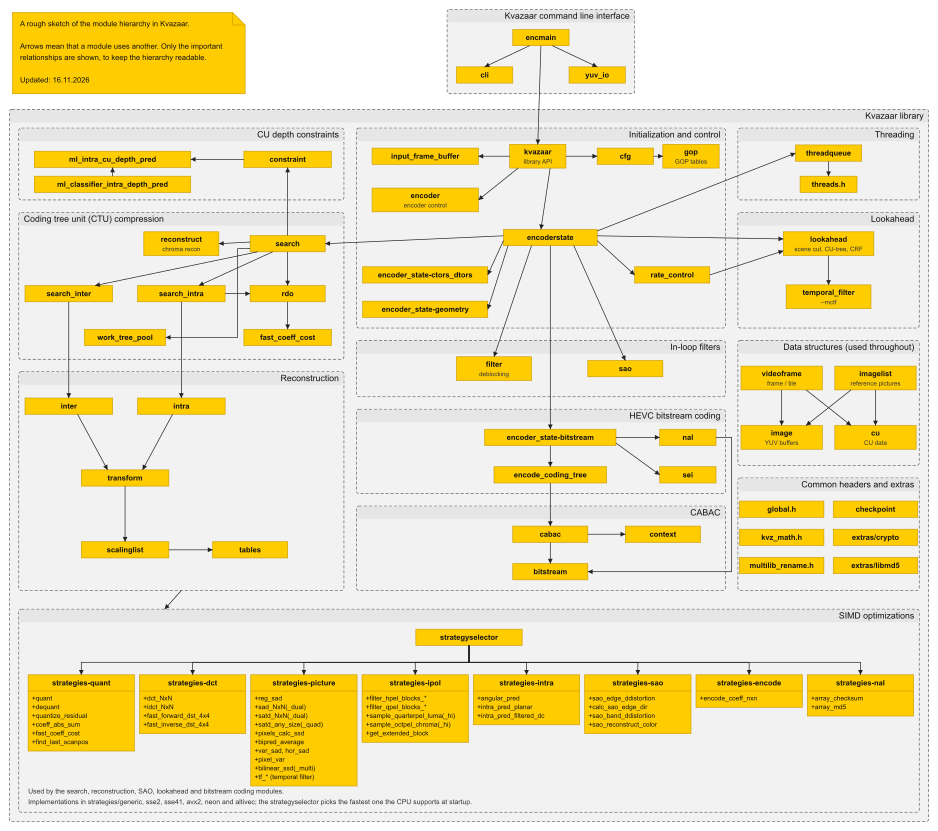

Kvazaar
=======
An open-source HEVC encoder licensed under 3-clause BSD

Join channel [#ultravideo](https://web.libera.chat/#ultravideo) in [Libera.Chat](https://libera.chat/) IRC network to contact us or come to our Discord [](https://discord.gg/fZpub7BPUA)

Kvazaar is still under development. Speed and RD-quality will continue to improve.

http://ultravideo.fi/#encoder for more information.

- Linux [](https://github.com/ultravideo/kvazaar/actions/workflows/kvazaar.yml)
- Windows [](https://ci.appveyor.com/project/Ultravideo/kvazaar)

## Table of Contents

- [Using Kvazaar](#using-kvazaar)
  - [Example:](#example)
  - [Parameters](#parameters)
  - [LP-GOP syntax](#lp-gop-syntax)
  - [Lookahead](#lookahead)
- [Presets](#presets)
- [Kvazaar library](#kvazaar-library)
- [Compiling Kvazaar](#compiling-kvazaar)
  - [Required libraries](#required-libraries)
  - [Range extensions (4:2:2 and 4:4:4)](#range-extensions)
  - [Autotools](#autotools)
  - [Autotools on MinGW](#autotools-on-mingw)
  - [OS X](#os-x)
  - [Visual Studio](#visual-studio)
  - [Docker](#docker)
  - [Visualization (Windows only)](#visualization-windows-only)
- [Paper](#paper)
- [Contributing to Kvazaar](#contributing-to-kvazaar)
  - [Code documentation](#code-documentation)
  - [For version control we try to follow these conventions:](#for-version-control-we-try-to-follow-these-conventions)
  - [Testing](#testing)
  - [Unit tests](#unit-tests)
  - [Code style](#code-style)

## Using Kvazaar

### Example:

    kvazaar --input BQMall_832x480_60.yuv --output out.hevc

The mandatory parameters are input and output. If the resolution of the input file is not in the filename, or when pipe is used, the input resolution must also be given: ```--input-res=1920x1080```.

The default input format is 8-bit yuv420p for 8-bit and yuv420p10le for 10-bit. Input format and bitdepth can be selected with ```--input-format``` and ```--input-bitdepth```.

Speed and compression quality can be selected with ```--preset```, or by setting the options manually.

### Parameters

[comment]: # "BEGIN KVAZAAR HELP MESSAGE"
```
Kvazaar v2.3.2 2025-09-16
Kvazaar license: 3-clause BSD
Usage:
kvazaar -i <input> --input-res <width>x<height> -o <output>

Required:
  -i, --input <filename>     : Input file
      --input-res <res>      : Input resolution [auto]
                                   - auto: Detect from file name.
                                   - <int>x<int>: width times height
  -o, --output <filename>    : Output file

Presets:
      --preset <preset>      : Set options to a preset [medium]
                                   - ultrafast, superfast, veryfast, faster,
                                     fast, medium, slow, slower, veryslow
                                     placebo

Input:
  -n, --frames <integer>     : Number of frames to code [all]
      --seek <integer>       : First frame to code [0]
      --input-fps <num>[/<denom>] : Frame rate of the input video [25]
      --source-scan-type <string> : Source scan type [progressive]
                                   - progressive: Progressive scan
                                   - tff: Top field first
                                   - bff: Bottom field first
      --input-format <string> : P420, P422, P444 or P400 [P420]
      --input-bitdepth <int> : 8-16 [8]
      --loop-input           : Re-read input file forever.
      --input-file-format <string> : Input file format [auto]
                                    - auto: Check the file ending for format
                                    - y4m (skips frame headers)
                                    - yuv

Options:
      --help                 : Print this help message and exit.
      --version              : Print version information and exit.
      --(no-)aud             : Use access unit delimiters. [disabled]
      --debug <filename>     : Output internal reconstruction.
      --(no-)cpuid           : Enable runtime CPU optimizations. [enabled]
      --hash <string>        : Decoded picture hash [checksum]
                                   - none: 0 bytes
                                   - checksum: 18 bytes
                                   - md5: 56 bytes
      --(no-)psnr            : Calculate PSNR for frames. [enabled]
      --(no-)info            : Add encoder info SEI. [enabled]
      --(no-)enable-logging  : Enable logging for regular encoder performance,
                               error messages are always disblayed. [enabled]
      --crypto <string>      : Selective encryption. Crypto support must be
                               enabled at compile-time. Can be 'on' or 'off' or
                               a list of features separated with a '+'. [off]
                                   - on: Enable all encryption features.
                                   - off: Disable selective encryption.
                                   - mvs: Motion vector magnitudes.
                                   - mv_signs: Motion vector signs.
                                   - trans_coeffs: Coefficient magnitudes.
                                   - trans_coeff_signs: Coefficient signs.
                                   - intra_pred_modes: Intra prediction modes.
      --key <string>         : Encryption key [16,213,27,56,255,127,242,112,
                                               97,126,197,204,25,59,38,30]
      --stats-file-prefix    : A prefix used for stats files that include
                               bits, lambda, distortion, and qp for each ctu.
                               These are meant for debugging and are not
                               written unless the prefix is defined.

Video structure:
  -q, --qp <integer>         : Quantization parameter [22]
  -p, --period <integer>     : Period of intra pictures [64]
                                   - 0: Only first picture is intra.
                                   - 1: All pictures are intra.
                                   - N: Every Nth picture is intra.
      --vps-period <integer> : How often the video parameter set is re-sent [0]
                                   - 0: Only send VPS with the first frame.
                                   - N: Send VPS with every Nth intra frame.
  -r, --ref <integer>        : Number of reference frames, in range 1..15 [4]
      --gop <string>         : GOP structure [16]
                                   -  0: Disabled
                                   -  8: B-frame pyramid of length 8
                                   - 16: B-frame pyramid of length 16
                                   - lp-<string>: Low-delay P/B-frame GOP
                                     (e.g. lp-g8d4t2, see README)
      --intra-qp-offset <int>: QP offset for intra frames [-51..51] [auto]
                                   - N: Set QP offset to N.
                                   - auto: Select offset automatically based
                                     on GOP length.
      --(no-)open-gop        : Use open GOP configuration. [enabled]
      --cqmfile <filename>   : Read custom quantization matrices from a file.
      --scaling-list <string>: Set scaling list mode. [off]
                                   - off: Disable scaling lists.
                                   - custom: use custom list (with --cqmfile).
                                   - default: Use default lists.
      --bitrate <integer>    : Target bitrate [0]
                                   - 0: Disable rate control.
                                   - N: Target N bits per second.
      --rc-algorithm <string>: Select used rc-algorithm. [lambda]
                                   - lambda: rate control from:
                                     DOI: 10.1109/TIP.2014.2336550 
                                   - oba: DOI: 10.1109/TCSVT.2016.2589878
                                   - abr: frame QP from the lookahead
                                     complexity, adjusted to reach the
                                     bitrate. Enables the lookahead.
      --(no-)intra-bits      : Use Hadamard cost based allocation for intra
                               frames. Default on for gop 8 and off for lp-gop
      --(no-)clip-neighbour  : On oba based rate control whether to clip 
                               lambda values to same frame's ctus or previous'.
                               Default on for RA GOPS and disabled for LP.
      --(no-)lossless        : Use lossless coding. [disabled]
      --mv-constraint <string> : Constrain movement vectors. [none]
                                   - none: No constraint
                                   - frametile: Constrain within the tile.
                                   - frametilemargin: Constrain even more.
      --roi <filename>       : Use a delta QP map for region of interest.
                               Reads an array of delta QP values from a file.
                               Text and binary files are supported and detected
                               from the file extension (.txt/.bin). If a known
                               extension is not found, the file is treated as
                               a text file. The file can include one or many
                               ROI frames each in the following format:
                               width and height of the QP delta map followed
                               by width * height delta QP values in raster
                               order. In binary format, width and height are
                               32-bit integers whereas the delta QP values are
                               signed 8-bit values. The map can be of any size
                               and will be scaled to the video size. The file
                               reading will loop if end of the file is reached.
                               See roi.txt in the examples folder.
      --set-qp-in-cu         : Set QP at CU level keeping pic_init_qp_minus26.
                               in PPS and slice_qp_delta in slize header zero.
      --(no-)erp-aqp         : Use adaptive QP for 360 degree video with
                               equirectangular projection. [disabled]
      --level <number>       : Use the given HEVC level in the output and give
                               an error if level limits are exceeded. [6.2]
                                   - 1, 2, 2.1, 3, 3.1, 4, 4.1, 5, 5.1, 5.2, 6,
                                     6.1, 6.2
      --force-level <number> : Same as --level but warnings instead of errors.
      --high-tier            : Used with --level. Use high tier bitrate limits
                               instead of the main tier limits during encoding.
                               High tier requires level 4 or higher.
      --(no-)vaq <integer>   : Enable variance adaptive quantization with given
                               strength, in range 1..20. Recommended: 5.
                               [disabled]
      --crf <float>          : Constant rate factor, 0..51. Selects the
                               frame QP from the frame complexity measured
                               by the lookahead. Enables the lookahead.
                               [disabled]
      --lookahead <integer>  : Number of frames analysed ahead of encoding,
                               0..250. Used for CRF, CU-tree, scene cut
                               detection and bitrate allocation. Adds
                               latency. [0, 20 with --crf]
      --qcomp <float>        : QP curve compression for CRF and lookahead
                               bit allocation, 0.0..1.0. [0.6]
      --(no-)cutree          : Temporal QP adaptation by propagating block
                               importance through the lookahead.
                               [enabled with lookahead]
      --cutree-strength <float>: CU-tree QP offset strength.
                               [3.75 * (1 - qcomp)]
      --(no-)scenecut <integer>: Scene cut detection threshold, 1..100.
                               Inserts an IDR picture at scene changes.
                               [40 with lookahead]
      --vbv-maxrate <integer>: VBV maximum bitrate in bits per second for
                               --crf and --rc-algorithm abr. [disabled]
      --vbv-bufsize <integer>: VBV buffer size in bits. [disabled]
      --vbv-init <float>     : Initial VBV buffer fullness. [0.9]
      --(no-)mctf            : Motion compensated temporal filtering of
                               the GOP key pictures before coding (random
                               access GOP). Enables the lookahead.
                               [disabled]
      --(no-)adaptive-gop    : The lookahead chooses the length of each
                               random access mini-GOP (1..2 * --gop), places
                               the periodic intra pictures at mini-GOP
                               anchors (--period is the maximum distance)
                               and does not treat flashes as scene cuts.
                               Enables the lookahead, adds 2 * --gop
                               pictures of latency. [disabled]

Compression tools:
      --(no-)deblock <beta:tc> : Deblocking filter. [0:0]
                                   - beta: Between -6 and 6
                                   - tc: Between -6 and 6
      --sao <string>         : Sample Adaptive Offset [full]
                                   - off: SAO disabled
                                   - band: Band offset only
                                   - edge: Edge offset only
                                   - full: Full SAO
      --(no-)rdoq            : Rate-distortion optimized quantization [enabled]
      --(no-)rdoq-skip       : Skip RDOQ for 4x4 blocks. [disabled]
      --(no-)signhide        : Sign hiding [disabled]
      --(no-)smp             : Symmetric motion partition [disabled]
      --(no-)amp             : Asymmetric motion partition [disabled]
      --rd <integer>         : Mode search complexity [0]
                                   - 0: Skip intra if inter is good enough.
                                   - 1: Rough intra mode search with SATD.
                                   - 2: Refine mode search with SSE.
                                   - 3: More SSE candidates for inter and
                                        chroma mode search for 4x4 intra.
                                   - 4: Even more SSE candidates for both.
                                   - 5: Try all intra modes.
      --(no-)mv-rdo          : Rate-distortion optimized motion vector costs
                               [disabled]
      --(no-)zero-coeff-rdo  : If a CU is set inter, check if forcing zero
                               residual improves the RD cost. [enabled]
      --(no-)full-intra-search : Try all intra modes during rough search.
                               [disabled]
      --(no-)intra-chroma-search : Test non-derived intra chroma modes.
                                   [disabled]
      --(no-)transform-skip  : Try transform skip [disabled]
      --me <string>          : Integer motion estimation algorithm [hexbs]
                                   - hexbs: Hexagon Based Search
                                   - tz:    Test Zone Search
                                   - full:  Full Search
                                   - full8, full16, full32, full64
                                   - dia:   Diamond Search
      --me-steps <integer>   : Motion estimation search step limit. Only
                               affects 'hexbs' and 'dia'. [-1]
      --subme <integer>      : Fractional pixel motion estimation level [4]
                                   - 0: Integer motion estimation only
                                   - 1: + 1/2-pixel horizontal and vertical
                                   - 2: + 1/2-pixel diagonal
                                   - 3: + 1/4-pixel horizontal and vertical
                                   - 4: + 1/4-pixel diagonal
      --(no-)fast-bipred     : Only perform fast bipred search. [enabled]
      --pu-depth-inter <int>-<int> : Inter prediction units sizes [0-3]
                                   - 0, 1, 2, 3: from 64x64 to 8x8
                                   - Accepts a list of values separated by ','
                                     for setting separate depths per GOP layer
                                     (values can be omitted to use the first
                                     value for the respective layer).
      --pu-depth-intra <int>-<int> : Intra prediction units sizes [1-4]
                                   - 0, 1, 2, 3, 4: from 64x64 to 4x4
                                   - Accepts a list of values separated by ','
                                     for setting separate depths per GOP layer
                                     (values can be omitted to use the first
                                     value for the respective layer).
      --ml-pu-depth-intra    : Predict the pu-depth-intra using machine
                                learning trees, overrides the
                                --pu-depth-intra parameter. [disabled]
      --(no-)combine-intra-cus: Whether the encoder tries to code a cu
                                   on lower depth even when search is not
                                   performed on said depth. Should only
                                   be disabled if cus absolutely must not
                                   be larger than limited by the search.
                                   [enabled]
      --force-inter          : Force the encoder to use inter always.
                               This is mostly for debugging and is not
                               guaranteed to produce sensible bitstream or
                               work at all. [disabled]
      --tr-depth-intra <int> : Transform split depth for intra blocks [0]
      --(no-)bipred          : Bi-prediction [enabled]
      --cu-split-termination <string> : CU split search termination [zero]
                                   - off: Don't terminate early.
                                   - zero: Terminate when residual is zero.
      --me-early-termination <string> : Motion estimation termination [on]
                                   - off: Don't terminate early.
                                   - on: Terminate early.
                                   - sensitive: Terminate even earlier.
      --fast-residual-cost <int> : Skip CABAC cost for residual coefficients
                                   when QP is below the limit. [0]
      --fast-coeff-table <string> : Read custom weights for residual
                                    coefficients from a file instead of using
                                    defaults [default]
      --fast-rd-sampling : Enable learning data sampling for fast coefficient
                           table generation
      --fastrd-accuracy-check : Evaluate the accuracy of fast coefficient
                                prediction
      --fastrd-outdir : Directory to which to output sampled data or accuracy
                        data, into <fastrd-outdir>/0.txt to 50.txt, one file
                        for each QP that blocks were estimated on
      --(no-)intra-rdo-et    : Check intra modes in rdo stage only until
                               a zero coefficient CU is found. [disabled]
      --(no-)early-skip      : Try to find skip cu from merge candidates.
                               Perform no further search if skip is found.
                               For rd=0..1: Try the first candidate.
                               For rd=2.. : Try the best candidate based
                                            on luma satd cost. [enabled]
      --max-merge <integer>  : Maximum number of merge candidates, 1..5 [5]
      --(no-)implicit-rdpcm  : Implicit residual DPCM. Currently only supported
                               with lossless coding. [disabled]
      --(no-)tmvp            : Temporal motion vector prediction [enabled]
      --(no-)cross-comp-pred : Cross-component prediction for 4:4:4 [disabled]

Parallel processing:
      --threads <integer>    : Number of threads to use [auto]
                                   - 0: Process everything with main thread.
                                   - N: Use N threads for encoding.
                                   - auto: Select automatically.
      --owf <integer>        : Frame-level parallelism [auto]
                                   - N: Process N+1 frames at a time.
                                   - auto: Select automatically.
      --(no-)wpp             : Wavefront parallel processing. [enabled]
                               Enabling tiles automatically disables WPP.
                               To enable WPP with tiles, re-enable it after
                               enabling tiles. Enabling wpp with tiles is,
                               however, an experimental feature since it is
                               not supported in any HEVC profile.
      --tiles <int>x<int>    : Split picture into width x height uniform tiles.
      --tiles-width-split <string>|u<int> :
                                   - <string>: A comma-separated list of tile
                                               column pixel coordinates.
                                   - u<int>: Number of tile columns of uniform
                                             width.
      --tiles-height-split <string>|u<int> :
                                   - <string>: A comma-separated list of tile
                                               row column pixel coordinates.
                                   - u<int>: Number of tile rows of uniform
                                             height.
      --slices <string>      : Control how slices are used.
                                   - tiles: Put tiles in independent slices.
                                   - wpp: Put rows in dependent slices.
                                   - tiles+wpp: Do both.
      --partial-coding <x-offset>!<y-offset>!<slice-width>!<slice-height>
                             : Encode partial frame.
                               Parts must be merged to form a valid bitstream.
                               X and Y are CTU offsets.
                               Slice width and height must be divisible by CTU
                               in pixels unless it is the last CTU row/column.
                               This parameter is used by kvaShare.

Video Usability Information:
      --sar <width:height>   : Specify sample aspect ratio
      --overscan <string>    : Specify crop overscan setting [undef]
                                   - undef, show, crop
      --videoformat <string> : Specify video format [undef]
                                   - undef, component, pal, ntsc, secam, mac
      --range <string>       : Specify color range [tv]
                                   - tv, pc
      --colorprim <string>   : Specify color primaries [undef]
                                   - undef, bt709, bt470m, bt470bg,
                                     smpte170m, smpte240m, film, bt2020
      --transfer <string>    : Specify transfer characteristics [undef]
                                   - undef, bt709, bt470m, bt470bg,
                                     smpte170m, smpte240m, linear, log100,
                                     log316, iec61966-2-4, bt1361e,
                                     iec61966-2-1, bt2020-10, bt2020-12
      --colormatrix <string> : Specify color matrix setting [undef]
                                   - undef, bt709, fcc, bt470bg, smpte170m,
                                     smpte240m, GBR, YCgCo, bt2020nc, bt2020c
      --chromaloc <integer>  : Specify chroma sample location (0 to 5) [0]

Deprecated parameters: (might be removed at some point)
  -w, --width <integer>       : Use --input-res.
  -h, --height <integer>      : Use --input-res.
```
[comment]: # "END KVAZAAR HELP MESSAGE"


### LP-GOP syntax
The LP-GOP syntax is "lp-g(num)d(num)t(num)", where
- g = GOP length.
- d = Number of GOP layers.
- t = How many references to skip for temporal scaling, where 4 means only
  every fourth picture needs to be decoded.

```
QP
+4  o o o o  
+3   o   o    o o o o
+2     o       o o o    ooooooo
+1 o       o o       o o       o ooooooooo
   g8d4t1    g8d3t1    g8d2t1    g8d1t1
```

### Lookahead
`--lookahead N` keeps N input pictures queued before they are encoded.
Each queued picture is downscaled by two and analysed with a cheap intra
and motion search on 8x8 low resolution blocks. The analysis is used by:

- **Scene cut detection** (`--scenecut`, default 40): when the inter cost
  of a picture is close to its intra cost the pictures before it are
  flushed with a shortened GOP and the picture is coded as an IDR that
  starts a new coded video sequence. The intra period restarts from it.
- **CU-tree** (`--cutree`, default on): the amount of information each
  block passes on to the following pictures is propagated backwards
  through the lookahead and converted into CTU QP offsets
  (`-strength * log2((intra + propagate) / intra)`, zero mean per picture,
  limited to +-4). Pictures that are not used for reference are not
  adapted.
- **CRF** (`--crf X`, `--qcomp`): the base QP of a picture is
  `X + 6 * (1 - qcomp) * log2(complexity / reference)`, where the
  complexity is the low resolution inter cost blurred over the neighbouring
  pictures of the same scene. The GOP QP offsets are applied on top as in
  the constant QP mode. CRF X gives roughly the bitrate of QP X.
- **ABR rate control** (`--bitrate N --rc-algorithm abr`): bits are
  modelled per GOP position as `k * complexity / qscale^1.3` with k learned
  from the coded pictures. Once per GOP the rate factor is chosen so that
  the pictures up to the end of the lookahead hit the target bitrate after
  correcting the error so far (including the pictures still being coded).
  The base QP changes at most 2 per GOP.

- **VBV** (`--vbv-maxrate`, `--vbv-bufsize`, `--vbv-init`, with CRF or
  ABR): before a picture is coded the buffer is simulated over the
  pictures being coded and the lookahead with the bits model, and the base
  QP is raised (by at most 20) until the buffer stays above 20 % of its
  size. The increase is released by at most 1 QP per picture. No HRD
  parameters are written to the bitstream.

- **Temporal filter** (`--mctf`, random access GOP of 8 or 16): every
  8th picture (counted from the start of the scene) is replaced before
  coding by a motion compensated, bilateral weighted average of itself and
  the two previous and two following pictures of the same scene, like the
  GOP based temporal filter of HM / VTM (8x8 hierarchical motion search,
  block error and noise based weights). These pictures are the references
  of the rest of the GOP, so removing their noise helps the whole GOP. The
  original pictures are still used for the PSNR output.

- **Motion search starting point**: the low resolution motion of each
  16x16 block is followed picture by picture (up to 16 pictures in each
  direction within the scene) to each reference picture and checked as an
  extra starting point of the integer motion search. This helps the
  hexagon / diamond searches of the fast presets to find large motion
  (-4.1 % ultrafast, -2.8 % medium, -0.6 % veryslow on top of the other
  lookahead tools, up to 5 % more time).

- **Adaptive GOP** (`--adaptive-gop`, random access GOP of 8 or 16): the
  pictures are released from the lookahead in coding order, one mini-GOP
  at a time, and the lookahead decides the structure:
  - Mini-GOP length: hierarchical mini-GOPs of 1 to 2 * `--gop` pictures.
    A mini-GOP is halved when the low resolution cost of the anchor
    predicted over the whole length plus the bi-predicted middle picture
    is more than 1.25 times the cost of the two halves predicted as
    anchors (searches seeded by the followed motion, range +-87 low
    resolution pixels). The pictures keep the QP and layer settings of
    the GOP table pictures at the same distance from their references. A
    32 picture mini-GOP uses the settings of the GOP 16 anchor for its
    middle picture and a 3 lower QP offset for its anchor.
  - References: a picture keeps the ends of the enclosing intervals of the
    hierarchy (and one earlier picture as in the GOP tables), an anchor
    the three pictures of the lowest layers. With mini-GOPs of `--gop`
    pictures the output is identical to the GOP tables.
  - Intra pictures: the periodic intra picture is the first mini-GOP
    anchor within the last `--gop` / 2 pictures of `--period` (a CRA, or
    an IDR with a closed GOP), so the mini-GOPs are not broken up before
    it. `--period` no longer needs to be a multiple of `--gop`.
  - Flashes: a scene cut is cancelled when one of the next three pictures
    is predicted well (inter cost below 0.7 * intra cost) from the
    picture before the cut, so a flash or a short disturbance does not
    insert IDR pictures. The flash pictures are coded as non-reference
    pictures with the QP of the highest GOP layer, they are left out of
    the references of the other pictures and a mini-GOP anchor is moved
    off a flash picture (to the nearest power of two length). Fades are
    still coded as references: coding the pictures of a cross-fade or a
    fade to black as non-reference pictures was 33-69 % worse.

  The pictures are held in the lookahead for 2 * `--gop` more pictures
  (latency and memory). The ABR bits model averages the GOP positions of
  the longest mini-GOP, and the rate factor is updated at the anchors and
  at the starts of the halves of the 32 picture mini-GOPs.

The lookahead analysis runs in its own thread when threads are enabled.
The results do not depend on the number of threads. With `--lookahead 0`
(the default) the encoder output is unchanged.

Measured BD-rate (Y-PSNR) against constant QP with the same preset,
QP 22..37 (bitrate targets taken from the constant QP runs), 96 frames of
BQMall, BasketballDrillText, Johnny, ChinaSpeed and a BQMall /
BasketballDrillText splice with two scene cuts, 2 threads:

| Mode                                     | ultrafast | medium  |
|------------------------------------------|-----------|---------|
| `--lookahead 20 --no-cutree` (scene cut) | -1.5 %    |         |
| `--lookahead 20`                         | -3.4 %    | -2.5 %  |
| `--crf X`                                | -4.0 %    | -2.6 %  |
| `--bitrate N` (lambda)                   | +17.7 %   | +22.5 % |
| `--bitrate N --lookahead 20` (lambda)    | +13.4 %   |         |
| `--bitrate N --rc-algorithm abr`         | +2.2 %    | +2.9 %  |
| `--lookahead 20 --mctf`                  | -6.2 %    |         |

With `--preset veryslow` (64 frames of the same sequences) `--lookahead
20` gives -2.7 % and `--lookahead 20 --mctf` -3.6 % (-4.5 % YUV). The
temporal filter (AVX2 motion search) adds about 80 ms of CPU time per
filtered 832x480 picture (one in eight pictures), about 4 % of the
veryslow encoding time but 1.8x the ultrafast time.

`--adaptive-gop` against `--lookahead 20` with the same preset (constant
QP 22-37, the first 96-144 pictures, `--period 64`):

| Sequence                     | ultrafast | medium  |
|------------------------------|-----------|---------|
| BQMall                       | -0.6 %    | -1.0 %  |
| BasketballDrillText          | -3.0 %    |         |
| Foreman                      | -3.3 %    | -1.0 %  |
| ChinaSpeed                   | -0.7 %    |         |
| Johnny                       | -3.0 %    | -2.4 %  |
| KristenAndSara               | -2.7 %    |         |
| SlideShow                    | -5.6 %    | -5.0 %  |
| Stockholm 1x / 4x speed mix  | -2.2 %    |         |
| Stockholm 4x speed           | -5.7 %    | -4.0 %  |
| Johnny-Kristen cross-fade    | -4.6 %    | -3.3 %  |
| Stockholm with 4 flashes     | -43.9 %   | -42.3 % |

Most of the gain of the natural sequences comes from the 32 picture
mini-GOPs. Shorter mini-GOPs than the GOP table were worse on all of these
sequences (`--gop 16` content coded as GOP 8: +1.0..+5.1 %), so the model
splits a mini-GOP only with a clear margin. The flash sequence gains from
not inserting IDR pictures at the flashes. Coding the flash pictures as
non-reference pictures gives a further -4.8 % (ultrafast) / -3.7 %
(medium) on it, and -21.1 % / -15.6 % on a version with weaker (+30 luma)
flashes where a 32 picture anchor fell on a flash; the other sequences
are unchanged. The CPU time is 0-5 % higher.

`--cutree-qg32` (CU-tree offsets per 32x32 quantization group instead of
per CTU) is experimental and off by default: -3.4 % at ultrafast like the
per-CTU offsets, and less gain than per-CTU offsets at veryslow.

The scene cut gain comes from the splice (-7.5 %), the other sequences
have no cuts. The mean absolute bitrate error of the ABR mode on these
short sequences is 3.3 % (ultrafast) / 7.5 % (medium) compared to 7.1 % /
8.1 % with the lambda rate control. The lookahead analysis takes about
11 ms per 2560x1600 picture, about 10 % of the encoding time with
ultrafast on two cores.

## Presets
The names of the presets are the same as with x264: ultrafast,
superfast, veryfast, faster, fast, medium, slow, slower, veryslow and
placebo. The effects of the presets are listed in the following table,
where the names have been abbreviated to fit the layout in GitHub.

|                      | 0-uf  | 1-sf  | 2-vf  | 3-fr  | 4-f   | 5-m   | 6-s   | 7-sr  | 8-vs  | 9-p   |
| -------------------- | ----- | ----- | ----- | ----- | ----- | ----- | ----- | ----- | ----- | ----- |
| rd                   | 0     | 0     | 0     | 0     | 0     | 0     | 1     | 2     | 3     | 3     |
| pu-depth-intra       | 2-3   | 2-3   | 2-3   | 2-3   | 1-3   | 1-4   | 1-4   | 1-4   | 1-4   | 1-4   |
| pu-depth-inter       | 1-2   | 1-2   | 1-3   | 1-3   | 1-3   | 0-3   | 0-3   | 0-3   | 0-3   | 0-3   |
| me                   | hexbs | hexbs | hexbs | hexbs | hexbs | hexbs | hexbs | hexbs | tz    | tz    |
| gop                  | 16    | 16    | 16    | 16    | 16    | 16    | 16    | 16    | 16    | 16    |
| ref                  | 1     | 1     | 1     | 1     | 2     | 4     | 4     | 4     | 4     | 4     |
| bipred               | 1     | 1     | 1     | 1     | 1     | 1     | 1     | 1     | 1     | 1     |
| deblock              | 1     | 1     | 1     | 1     | 1     | 1     | 1     | 1     | 1     | 1     |
| signhide             | 0     | 0     | 0     | 0     | 0     | 0     | 0     | 1     | 1     | 1     |
| subme                | 0     | 2     | 2     | 4     | 4     | 4     | 4     | 4     | 4     | 4     |
| sao                  | off   | full  | full  | full  | full  | full  | full  | full  | full  | full  |
| rdoq                 | 0     | 0     | 0     | 0     | 0     | 1     | 1     | 1     | 1     | 1     |
| rdoq-skip            | 0     | 0     | 0     | 0     | 0     | 0     | 0     | 0     | 0     | 0     |
| transform-skip       | 0     | 0     | 0     | 0     | 0     | 0     | 0     | 0     | 1     | 1     |
| mv-rdo               | 0     | 0     | 0     | 0     | 0     | 0     | 0     | 0     | 0     | 1     |
| full-intra-search    | 0     | 0     | 0     | 0     | 0     | 0     | 0     | 0     | 0     | 0     |
| smp                  | 0     | 0     | 0     | 0     | 0     | 0     | 0     | 0     | 1     | 1     |
| amp                  | 0     | 0     | 0     | 0     | 0     | 0     | 0     | 0     | 1     | 1     |
| cu-split-termination | zero  | zero  | zero  | zero  | zero  | zero  | zero  | zero  | zero  | off   |
| me-early-termination | sens. | sens. | sens. | sens. | sens. | on    | on    | off   | off   | off   |
| intra-rdo-et         | 0     | 0     | 0     | 0     | 0     | 0     | 0     | 0     | 0     | 0     |
| early-skip           | 1     | 1     | 1     | 1     | 1     | 1     | 1     | 1     | 1     | 0     |
| fast-residual-cost   | 28    | 28    | 28    | 0     | 0     | 0     | 0     | 0     | 0     | 0     |
| max-merge            | 5     | 5     | 5     | 5     | 5     | 5     | 5     | 5     | 5     | 5     |


## Kvazaar library
See [kvazaar.h](src/kvazaar.h) for the library API and its
documentation.

When using the static Kvazaar library on Windows, macro `KVZ_STATIC_LIB`
must be defined. On other platforms it's not strictly required.

The needed linker and compiler flags can be obtained with pkg-config.


## Compiling Kvazaar
If you have trouble regarding compiling the source code, please make an
[issue](https://github.com/ultravideo/kvazaar/issues) about in Github.
Others might encounter the same problem and there is probably much to
improve in the build process. We want to make this as simple as
possible.

### Range Extensions

Add `-DKVZ_RANGE_EXTENSION` to CFLAGS for 4:2:2 and 4:4:4 support, there is some speed penalty to 4:2:0 just by enabling it so it's disabled by default.

With CMake `-DUSE_RANGE_EXTENSION=ON` can be used.


### Autotools
Depending on the platform, some additional tools are required for compiling Kvazaar with autotools.
For Ubuntu, the required packages are `automake autoconf libtool m4 build-essential`.


Run the following commands to compile and install Kvazaar.

    ./autogen.sh
    ./configure
    make
    sudo make install
    sudo ldconfig

See `./configure --help` for more options.
**When building shared library with visual studio the tests will fail to link, the main binary will still work**

### Autotools on MinGW
It is recommended to use Clang instead of GCC in MinGW environments. GCC also works, but AVX2 optimizations will be disabled because of a known GCC issue from 2012, so performance will suffer badly. Instead of `./configure`, run

    CC=clang ./configure

to build Kvazaar using Clang.

### CMake
Depending on the platform, some additional tools are required for compiling Kvazaar with CMake.
For Ubuntu, the required packages are `build-essential cmake`.


### OS X
- Install Homebrew
- run ```brew install automake libtool yasm```
- Refer to Autotools instructions


### Visual Studio
- At least VisualStudio 2015.2 is required.
- Project files can be found under build/.
- Requires external [vsyasm.exe](http://yasm.tortall.net/Download.html)
  in %PATH%


### Docker
This project includes a [Dockerfile](./Dockerfile), which enables building for Docker. Kvazaar is also available in the Docker Hub [`ultravideo/kvazaar`](https://hub.docker.com/r/ultravideo/kvazaar/)
Build using Docker: `docker build -t kvazaar .`
Example usage: `docker run -i -a STDIN -a STDOUT kvazaar -i - --input-res=320x240 -o - < testfile_320x240.yuv > out.265`
For other examples, see [Dockerfile](./Dockerfile)


### Visualization (Windows only)
Compiling `kvazaar_cli` project in the `visualizer` branch results in a Kvazaar executable with visualization enabled.

Additional Requirements: [`SDL2`](https://www.libsdl.org/download-2.0.php), [`SDL2-ttf`](https://www.libsdl.org/projects/SDL_ttf/).

Directory `visualizer_extras` has to be added into the same directory level as the kvazaar project directory. Inside should be directories `include` and `lib` found from the development library zip packages.

`SDL2.dll`, `SDL2_ttf.dll`, `libfreetype-6.dll`, and `zlib1.dll` should be placed in the working directory (i.e. the folder the `kvazaar.exe` is in after compiling the `kvazaar_cli` project/solution) when running the visualizer. The required `.dll` can be found in the aforementioned `lib`-folder (`lib\x64`).

Note: The solution should be compiled on the x64 platform in visual studio.

Optional font file `arial.ttf` is to be placed in the working directory, if block info tool is used.

## Paper

Please cite [this paper](https://dl.acm.org/citation.cfm?doid=2964284.2973796) for Kvazaar:

```M. Viitanen, A. Koivula, A. Lemmetti, A. Ylä-Outinen, J. Vanne, and T. D. Hämäläinen, “Kvazaar: open-source HEVC/H.265 encoder,” in Proc. ACM Int. Conf. Multimedia, Amsterdam, The Netherlands, Oct. 2016.```

Or in BibTex:

```
@inproceedings{Kvazaar2016,
 author = {Viitanen, Marko and Koivula, Ari and Lemmetti, Ari and Yl\"{a}-Outinen, Arttu and Vanne, Jarno and H\"{a}m\"{a}l\"{a}inen, Timo D.},
 title = {Kvazaar: Open-Source HEVC/H.265 Encoder},
 booktitle = {Proceedings of the 24th ACM International Conference on Multimedia},
 year = {2016},
 isbn = {978-1-4503-3603-1},
 location = {Amsterdam, The Netherlands},
 url = {http://doi.acm.org/10.1145/2964284.2973796},
}
```

## Contributing to Kvazaar
We are happy to look at pull requests in Github. There is still lots of work to be done.


### Code documentation
You can generate Doxygen documentation pages by running the command
"doxygen docs.doxy". Here is a rough sketch of the module structure:



### For version control we try to follow these conventions:
- Master branch always produces a working bitstream (can be decoded with
  HM).
- Commits for new features and major changes/fixes put to a sensibly
  named feature branch first and later merged to the master branch.
- Always merge the feature branch to the master branch, not the other
  way around, with fast-forwarding disabled if necessary.
- Every commit should at least compile.


### Testing
- Main automatic way of testing is with Travis CI. Commits, branches
  and pull requests are tested automatically.
  - Uninitialized variables and such are checked with Valgrind.
  - Bitstream validity is checked with VTM.
  - Compilation is checked on GCC and Clang on Linux, and Clang on OSX.
- Windows msys2 and msvc builds are checked automatically on Appveyor.
- If your changes change the bitstream, decode with HM to check that
  it doesn't throw checksum errors or asserts.
- If your changes shouldn't alter the bitstream, check that they don't.
- Automatic compression quality testing is in the works.


### Unit tests
- There are some unit tests located in the tests directory. We would
  like to have more.
- The Visual Studio project links the unit tests against the actual .lib
  file used by the encoder. There is no Makefile as of yet.
- The unit tests use "greatest" unit testing framework. It is included
  as a submodule, but getting it requires the following commands to be
  run in the root directory of kvazaar:

        git submodule init
        git submodule update

- On Linux, configure kvazaar with ```./configure --enable-static```,
  run ```make check```.


### Code style
We try to follow the following conventions:
- C99 without features not supported by Visual Studio 2015 (VLAs).
 - // comments allowed and encouraged.
- Follow overall conventions already established in the code.
- Indent by 2 spaces. (no tabs)
- { on the same line for control logic and on the next line for functions
- Reference and deference next to the variable name.
- Variable names in lowered characters with words divided by underscore.
- Maximum line length 79 characters when possible.
- Functions only used inside the module shouldn't be defined in the
  module header. They can be defined in the beginning of the .c file if
  necessary.
- Symbols defined in headers prefixed with kvz_ or KVZ_.
- Includes in alphabetic order.
